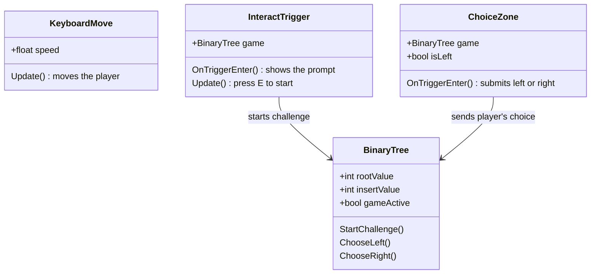

# Data Structure Garden 🌱

A 3D learning game prototype, built in Unity with C#, that teaches various data structures and algorithms through different areas of a garden. Students learn by walking through the garden and making choices, not by reading diagrams.

*Final year project: BSc Computer Science and Software Engineering, Maynooth University (2026)*

## The idea

Students usually learn binary search trees from diagrams on a page. The rule ("smaller goes left, bigger goes right") sounds simple, but it's easy to memorise without really understanding it. Data Structure Garden turns that rule into a choice you make with your feet: you're given a value, you walk into the garden, and you pick the left or right path depending on how your value compares with the one at the root.

## The garden

| Area | Teaches | Status |
|------|---------|--------|
| 🌳 **Binary Tree** | Binary search tree insertion | Playable: code in this repository |
| 🦆 **Queue Pond** | Queues (first in, first out) | Built in a later version that isn't in this repository |
| 🥕 **Vegetable Patch** | Sorting algorithms | Designed and laid out, not finished |

## How the Binary Tree challenge plays

1. Walk around the garden with the **arrow keys / WASD**.
2. Walk up to the tree and press **E** to start the Binary Tree Challenge.
3. You're shown the value to insert (e.g. **6**) and the root value (e.g. **8**).
4. Walk into the **left** or **right** path zone to make your choice.
5. The game tells you if you're right. If you're wrong, try the other path.

## How it's built

The project is split into small, single-purpose C# components that talk to each other through Unity's trigger events:

| Script | What it does |
|--------|--------------|
| `BinaryTree.cs` | Holds the challenge state and checks whether the player's choice follows the BST insertion rule |
| `ChoiceZone.cs` | A trigger zone on each path; when the player walks in, it submits "left" or "right" |
| `InteractTrigger.cs` | Shows the start prompt near the tree and starts the challenge when the player presses E |
| `KeyboardMove.cs` | Simple keyboard movement for the player |

**Design choices**

- **Game logic is kept separate from the scene.** All the rules live in `BinaryTree`; the zones only report what the player did. That makes it easy to change values or add more levels without touching the trigger code.
- **One reusable script for both paths.** A single `ChoiceZone` component handles left and right with one setting (`isLeft`), so there's no duplicated code.
- **Values are set in the Unity Inspector**, so new challenges can be created without changing any code.

## Scope and what I learned

The project started as a VR experience. Partway through, I re-scoped it to a desktop prototype so I could deliver a working, testable version on time. That was the most valuable lesson of the project: cutting scope to ship something that works, then building on it.

## What I'd build next

- Multi-level trees, so a value keeps travelling down until it finds its place
- On-screen UI feedback instead of console messages
- Random values for each round, plus a score
- Finish the Vegetable Patch so students can sort vegetables step by step (e.g. by size)
- Bring the Queue Pond back into this repository
- More structures, such as stacks and linked lists, as new areas of the garden
- Only allow the challenge to start when the player is standing near the tree

## Tech

**Unity** · **C#** · **Blender** (3D models) · **Git**

## Author

**Sriya Sambaturu** · [LinkedIn](www.linkedin.com/in/sriya-sambaturu-014b91302)
