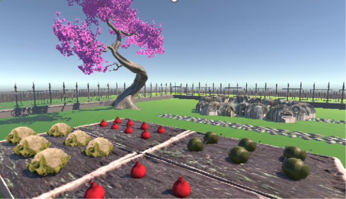
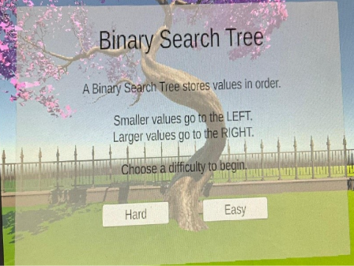
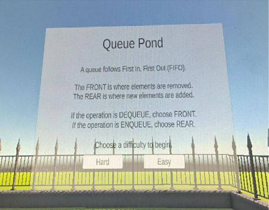
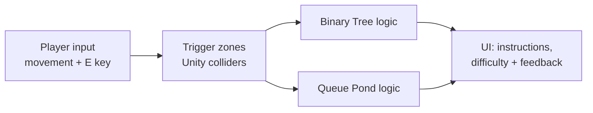

# Data Structure Garden 🌱

A 3D learning game, built in Unity with C#, that teaches various data structures and algorithms through different areas of a garden. Instead of reading diagrams, students walk through the garden and solve challenges, getting instant feedback on every decision.

*Final year project: BSc Computer Science and Software Engineering, Maynooth University (2026)*




## Why I built it

Data structures are a core part of any computer science degree, but they're abstract: students usually meet them as static diagrams and pseudocode, which show the result of an operation but not the steps that lead to it. Research on algorithm visualisation and game-based learning suggests that students understand better when they *actively interact* with a concept. Data Structure Garden turns each data structure into a place you can walk into and a challenge you can play.

## The garden

| Area | Teaches | Status |
|------|---------|--------|
| 🌳 **Binary Tree** | Binary search tree insertion | Complete |
| 🦆 **Queue Pond** | Queues: enqueue, dequeue, first in first out | Complete |
| 🥕 **Vegetable Patch** | Insertion sort | Environment built; activity planned |

### 🌳 Binary Tree

Walk up to the tree and press **E** to open the tutorial, then pick **Easy** or **Hard**. You're given a value to insert, and at each node you walk into the **left** or **right** path depending on whether your value is smaller or larger. The challenge continues step by step until you reach the correct insertion point. Wrong choices get an explanation so you can try again.



### 🦆 Queue Pond

The pond shows a queue of values. Each round, the game asks you to perform an **enqueue** or a **dequeue**, and you choose whether it happens at the **front** or the **rear** of the queue. Correct answers update the queue on screen; wrong answers get feedback explaining first in, first out (FIFO).



## How it's built



- **Modular, event-driven design.** Each learning area is controlled by its own C# scripts, so activities run independently and new areas can be added without changing existing ones. Unity trigger colliders start each activity when the player walks in.
- **Logic separate from the interface.** The data structure logic doesn't depend on the UI, which kept the code easier to change during development.
- **Designed before building.** The design is documented with UML use case and class diagrams in the project report.

### Code highlights

Recursive binary search tree insertion:

```csharp
private class BSTNode
{
    public int value;
    public BSTNode left;
    public BSTNode right;

    public BSTNode(int v) { value = v; }
}

private BSTNode InsertNode(BSTNode node, int value)
{
    if (node == null)
        return new BSTNode(value);

    if (value < node.value)
        node.left = InsertNode(node.left, value);
    else if (value > node.value)
        node.right = InsertNode(node.right, value);

    return node;
}
```

Checking the player's queue choice and updating the queue:

```csharp
private void SubmitChoice(bool choseFront)
{
    if (currentOperation == QueueOperation.Dequeue && choseFront)
        queueValues.RemoveAt(0);              // dequeue: remove from the front
    else if (currentOperation == QueueOperation.Enqueue && !choseFront)
        queueValues.Add(pendingValue);        // enqueue: add to the rear
}
```

## Testing and evaluation

- **Functional testing:** I wrote test cases for every interaction (entering zones, choosing difficulty, correct and incorrect choices, repeated queue operations) and ran them repeatedly in Unity, using console logs and runtime inspection to check the values.
- **User testing:** two participants (one beginner, one with some prior knowledge) played both activities and rated the game on a usability questionnaire based on the System Usability Scale.

| Statement | Beginner | Some knowledge |
|-----------|:--------:|:--------------:|
| The environment made learning more engaging | 5/5 | 5/5 |
| The system was easy to navigate | 4/5 | 4/5 |
| The challenges helped me understand the data structures | 4/5 | 4/5 |
| The instructions were clear | 3/5 | 4/5 |

The main takeaway was that beginners need clearer first-time instructions, which is now first on the list of improvements below.

## What I learned

- **Scoping to deliver.** The project started as a VR experience; I moved it to a desktop build so I could deliver two complete, tested activities on time.
- **Listening to users.** Even a small user test showed something I'd missed: the instructions made sense to me, but not to a complete beginner.
- **Unity and C#:** colliders and triggers, UI canvases, organising game logic into reusable components, and debugging with Unity's tools.

## What I'd build next

- Finish the Vegetable Patch: sort vegetables by size, step by step, using insertion sort
- Clearer, step-by-step tutorials for complete beginners
- Animated visuals, such as the tree growing as values are inserted and frogs lining up in the pond queue
- More areas, such as stacks and graphs

## About this repository

The final version of the project was stored on Maynooth University's GitLab, which I no longer have access to. This repository contains the **early prototype scripts** from my local copy (`BinaryTree.cs`, `ChoiceZone.cs`, `InteractTrigger.cs`, `KeyboardMove.cs`). The code highlights and screenshots above are from the final version.

## Tech

**Unity** · **C#** · **Blender** and **Sketchfab** (3D models) · **Git / GitLab** · **Microsoft Copilot** (debugging support)


## Author
**Sriya Sambaturu** · [LinkedIn](www.linkedin.com/in/sriya-sambaturu-014b91302)
